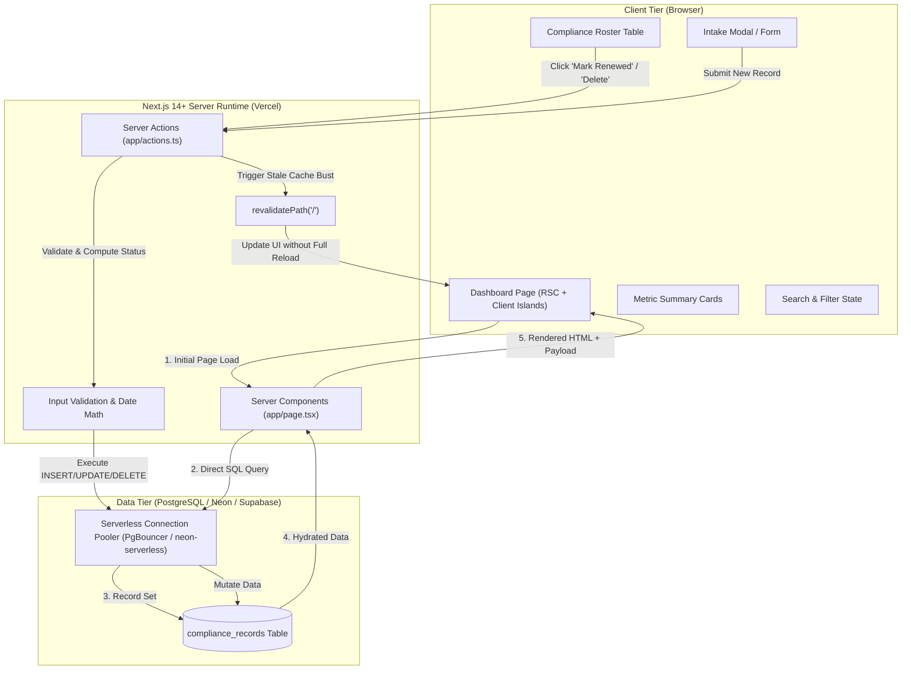

# Technical Specification: Compliance Training & Certification Tracker

## 1. Executive Architecture & Data Flow

The application utilizes Next.js 14+ App Router, leveraging React Server Components (RSC) for zero-client-JS initial data rendering, Server Actions for mutations, and a serverless PostgreSQL instance (Neon or Supabase) connected via pooled connections.

### System Architecture Diagram



---

## 2. Database Schema (`compliance_records`)

To guarantee completion in 60 minutes while supporting all interview requirements, a single denormalized table structure is used. This eliminates join overhead, transaction orchestration complexities, and foreign key race conditions during live demonstration.

### Standard SQL Definition

```sql
-- Enable UUID generation if not already active
CREATE EXTENSION IF NOT EXISTS "uuid-ossp";

-- Drop table if resetting during rehearsal
-- DROP TABLE IF EXISTS compliance_records;

CREATE TABLE compliance_records (
    id UUID PRIMARY KEY DEFAULT gen_random_uuid(),
    employee_name VARCHAR(255) NOT NULL,
    employee_email VARCHAR(255) NOT NULL,
    department VARCHAR(100) NOT NULL,
    course_name VARCHAR(255) NOT NULL,
    completion_date DATE NOT NULL,
    expiration_date DATE NOT NULL,
    status VARCHAR(50) NOT NULL DEFAULT 'COMPLIANT',
    created_at TIMESTAMPTZ NOT NULL DEFAULT NOW()
);

-- Performance Indexes for search and dashboard aggregations
CREATE INDEX idx_compliance_records_department ON compliance_records(department);
CREATE INDEX idx_compliance_records_status ON compliance_records(status);
CREATE INDEX idx_compliance_records_expiration ON compliance_records(expiration_date ASC);
```

### Realistic Seed Data (Copy-pasteable SQL)

```sql
INSERT INTO compliance_records (employee_name, employee_email, department, course_name, completion_date, expiration_date, status)
VALUES
  -- Fully Compliant (expires far in the future)
  ('Sarah Connor', 's.connor@cyberdyne.io', 'Security', 'SOC2 Security Awareness 2026', CURRENT_DATE - INTERVAL '60 days', CURRENT_DATE + INTERVAL '305 days', 'COMPLIANT'),
  ('Marcus Wright', 'm.wright@cyberdyne.io', 'Engineering', 'AWS Certified Solutions Architect', CURRENT_DATE - INTERVAL '180 days', CURRENT_DATE + INTERVAL '185 days', 'COMPLIANT'),
  ('Elena Rostova', 'e.rostova@cyberdyne.io', 'Finance', 'Anti-Money Laundering (AML) v3', CURRENT_DATE - INTERVAL '90 days', CURRENT_DATE + INTERVAL '275 days', 'COMPLIANT'),

  -- Expiring Soon (expires within 30 days)
  ('James Holden', 'j.holden@cyberdyne.io', 'Operations', 'OSHA Standard Safety Protocol', CURRENT_DATE - INTERVAL '345 days', CURRENT_DATE + INTERVAL '20 days', 'EXPIRING_SOON'),
  ('Naomi Nagata', 'n.nagata@cyberdyne.io', 'Engineering', 'Secure Code Review & OWASP Top 10', CURRENT_DATE - INTERVAL '355 days', CURRENT_DATE + INTERVAL '10 days', 'EXPIRING_SOON'),

  -- Overdue / Non-Compliant (already expired)
  ('Alex Kamal', 'a.kamal@cyberdyne.io', 'Operations', 'Hazardous Materials Handling', CURRENT_DATE - INTERVAL '400 days', CURRENT_DATE - INTERVAL '35 days', 'EXPIRED'),
  ('Amos Burton', 'a.burton@cyberdyne.io', 'Security', 'Physical Security & Access Control', CURRENT_DATE - INTERVAL '420 days', CURRENT_DATE - INTERVAL '55 days', 'EXPIRED');
```

---

## 3. Core API & Server Action Interfaces

### TypeScript Domain Models

```typescript
// types/compliance.ts

export type ComplianceStatus = 'COMPLIANT' | 'EXPIRING_SOON' | 'EXPIRED';

export interface ComplianceRecord {
  id: string;
  employee_name: string;
  employee_email: string;
  department: string;
  course_name: string;
  completion_date: string; // ISO string (YYYY-MM-DD)
  expiration_date: string; // ISO string (YYYY-MM-DD)
  status: ComplianceStatus;
  created_at: string;
}

export interface CreateRecordInput {
  employee_name: string;
  employee_email: string;
  department: string;
  course_name: string;
  completion_date: string; // YYYY-MM-DD
  expiration_date: string; // YYYY-MM-DD
}

export interface MetricSummary {
  total: number;
  compliant: number;
  expiringSoon: number;
  expired: number;
  complianceRate: number; // Percentage rounded to 1 decimal
}

export interface ActionResponse<T = unknown> {
  success: boolean;
  data?: T;
  error?: string;
}
```

### Server Action Signatures (`app/actions.ts`)

```typescript
'use server';

import { ComplianceRecord, CreateRecordInput, ActionResponse } from '@/types/compliance';

/**
 * Fetches compliance records with optional server-side filtering.
 */
export async function getComplianceRecords(filters?: {
  department?: string;
  status?: string;
  search?: string;
}): Promise<ComplianceRecord[]>;

/**
 * Creates a new compliance record, automatically computing its initial status.
 */
export async function createComplianceRecord(
  data: CreateRecordInput
): Promise<ActionResponse<ComplianceRecord>>;

/**
 * Advances a record's expiration date (default +1 year from today),
 * recalculates status to COMPLIANT, and revalidates cache.
 */
export async function renewComplianceRecord(
  id: string,
  validityYears?: number
): Promise<ActionResponse<ComplianceRecord>>;

/**
 * Deletes a record by ID and revalidates dashboard cache.
 */
export async function deleteComplianceRecord(
  id: string
): Promise<ActionResponse<{ id: string }>>;

/**
 * Resets or re-seeds the database with rich sample presentation data
 * (guarantees a pristine state during live interview demos).
 */
export async function resetDemoData(): Promise<ActionResponse<{ count: number }>>;
```

---

## 4. Dynamic Logic: Compliance Health Calculation

To prevent date-desynchronization anomalies between the database and the client, dynamic status evaluation is computed both on write (for indexing) and runtime evaluation (for display certainty).

### Thresholds & Exact Conditions

Given:
- $\text{Today} = \text{Current date at midnight (UTC)}$
- $\text{ExpirationDate} = \text{Record expiration date at midnight (UTC)}$
- $\Delta\text{Days} = \lfloor (\text{ExpirationDate} - \text{Today}) / (1000 \times 60 \times 60 \times 24) \rfloor$

| Condition | Calculated Status | Badge Style (Tailwind) | Description |
| :--- | :--- | :--- | :--- |
| $\Delta\text{Days} < 0$ | `EXPIRED` | `bg-rose-100 text-rose-800 border-rose-200` | Non-compliant / Overdue audit hazard |
| $0 \le \Delta\text{Days} \le 30$ | `EXPIRING_SOON` | `bg-amber-100 text-amber-800 border-amber-200` | Action required within 30-day window |
| $\Delta\text{Days} > 30$ | `COMPLIANT` | `bg-emerald-100 text-emerald-800 border-emerald-200` | Active and fully audited |

### TypeScript Calculation Function (`lib/compliance-utils.ts`)

```typescript
import { ComplianceStatus } from '@/types/compliance';

export function calculateComplianceStatus(expirationDateStr: string | Date): {
  status: ComplianceStatus;
  daysRemaining: number;
} {
  const today = new Date();
  today.setHours(0, 0, 0, 0);

  const expiration = new Date(expirationDateStr);
  expiration.setHours(0, 0, 0, 0);

  const diffMs = expiration.getTime() - today.getTime();
  const daysRemaining = Math.ceil(diffMs / (1000 * 60 * 60 * 24));

  if (daysRemaining < 0) {
    return { status: 'EXPIRED', daysRemaining };
  } else if (daysRemaining <= 30) {
    return { status: 'EXPIRING_SOON', daysRemaining };
  } else {
    return { status: 'COMPLIANT', daysRemaining };
  }
}
```
